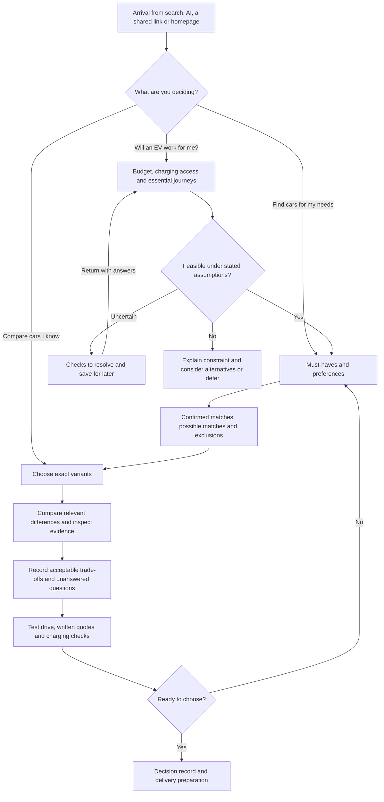

# EV buyer groups and website journeys

EV Side by Side already provides a substantial comparison layer. Its largest opportunity is to connect that layer to two decisions: whether an EV fits the visitor's circumstances, and what they must verify before buying. Preserve the fast route for people who already know their cars, while adding a route that begins with the buyer's needs.

This assessment covers Australian EV consideration and purchase, the current repository, and publicly retrieved deployment HTML as at 11 October 2026. It proposes product changes; it does not implement them. Public HTML was inspected, but live browser interactions were unavailable. Behaviours described below are supported by application code, rather than a new end-to-end usability test.

## What the website currently supports

| Surface | Existing capability | Boundary that matters to buyers |
| --- | --- | --- |
| `/` | Model Y against nine alternative families; exact trim selectors; seven chapters; synchronised rival navigation; chapter jumps; topic priority; link into the selected comparison | Model Y is fixed as the reference. Price and automated driving remain the first two chapters. The source homepage now opens with a Model Y editorial recommendation. |
| `/cars` | Search; family, availability, listed-price, claimed-range, drive, seats and equipment filters; vehicle detail links; comparison tray; reopen a locally saved shortlist | Ten families and 34 variant records are a researched subset of the market. Budget is list/base price. Unknown values remain in results. Only one equipment filter is selected at a time. |
| `/compare` | Model Y plus one or two other variants; Overview, All features and Software views; Differences only; feature search and category filter; evidence; link sharing; copy for AI; local shortlist saving; printing | Two non-Tesla cars can be included together, but Model Y consumes one of the three slots and cannot be removed. Saving stores selected vehicle IDs, not a full household decision record. |
| `/comparisons` and `/compare/[pair]` | Nine stable Model Y pair pages; key facts; buyer questions; inline sources; Markdown and JSON exports | Useful for search and AI arrivals, but all permanent pairs contain Model Y. These pages use defined trims rather than every possible combination. |
| `/cars/[family]/[variant]` | Exact Australian variant facts, equipment, caveats, software history and comparison entry | Describes a researched variant, not a particular used car, live dealer inventory or a personalised recommendation. |
| `/model-y` and `/software` | Dedicated Model Y and software exploration | Strongest for people already considering these models or capabilities. |
| `/glossary` | WLTP, LFP, V2L, FBT and driveaway definitions | Five terms do not form a beginner course. Each comparison-row link goes to the same Model Y/Sealion 7 pair, rather than the visitor's selection. |
| `/methodology` and `/sources` | Research basis, dates, uncertainty, limitations and original evidence | No working public correction inbox. Evidence dates must be interpreted separately from page-update dates. |

There is a deployment difference to resolve before redesign work. Public HTML has a top navigation with All EVs, Pair comparisons, Model Y range, Explore cars and Software updates. The current source layout lacks that header and uses the newer Model Y editorial introduction. Consequently, catalogue discoverability is weaker in the current source than in the retrieved deployment. Both versions retain a Model Y-centred comparison model. The shared methodology also says the shortlist is not a verified national top-ten ranking while homepage text makes a dated top-ten coverage claim; align those explanations.

## How to segment and rank buyers

Use three independent dimensions:

1. **Decision need:** what problem is the person trying to solve today?
2. **Understanding:** how much explanation do they need for this topic?
3. **Readiness:** are they exploring, checking feasibility, shortlisting, verifying, deciding or preparing for delivery?

A family buyer can also be a renter, a cost optimiser and an experienced EV owner. Let visitors select multiple concerns and nominate the one blocking their decision. Do not make them choose a rigid persona or infer it from age, gender or income.

The rankings are product-priority hypotheses for this website. They weigh purchase proximity, fit with existing capabilities, significance of the decision barrier and reuse of an improvement across other groups. They are not market shares, conversion forecasts or a ranking of whose needs matter. Adjacent ranks should change when user research provides better evidence.

Australian owner research supports treating charging, range and cost as major decision topics. The EVC and University of Sydney survey included 1,839 owners, surveyed in May–July 2025, and its published owner findings exclude the additional non-owner responses. It therefore supplies context, not a validated segmentation of this website's prospective visitors. [EV Ownership Survey second edition](https://www.sydney.edu.au/content/dam/corporate/documents/business-school/research/itls/2025-ownership-survey.pdf).

The March 2026 release reports that 93% of surveyed owners could charge at home. A public-charging-dependent visitor needs a separate feasibility path; home-charging owner experience cannot establish that their situation will work. [EVC survey release](https://electricvehiclecouncil.com.au/media-releases/australians-driving-evs-are-saving-more-than-ever-before-and-getting-comfortable-doing-it/).

| Rank | Buyer group | Primary decision | Current support | Why this priority |
| --- | --- | --- | --- | --- |
| 1 | Model Y and named-model cross-shoppers | Which exact model and trim should I choose? | Strong for Model Y; partial for other pairs | Closest fit to the existing proposition and a short path to a useful decision. |
| 2 | Practical first-EV switchers | Will an EV work as my normal car? | Partial | A feasibility entry can help many other groups and prevent premature specification browsing. |
| 3 | Budget and total-cost buyers | Can I afford the whole ownership experience? | Partial | Existing cost evidence provides a starting point, but personal assumptions determine the answer. |
| 4 | Family and everyday-usability buyers | Will this work for everyone and everything we carry? | Partial | Existing space, safety and convenience coverage is substantial; physical fit and joint decisions remain unresolved. |
| 5 | Buyers without reliable home charging | Can I build a workable charging routine? | Limited | Charging access can stop the purchase regardless of which car wins a comparison. |
| 6 | Regional, long-trip and towing buyers | Will it handle my difficult trips predictably? | Partial | Needs a journey-level answer beyond laboratory range and charging specifications. |
| 7 | Novated-lease and employer-supported buyers | Which vehicle and purchase arrangement fit my circumstances? | Partial | High decision specificity; existing FBT content needs a quote and eligibility verification workflow. |
| 8 | Experienced EV owners and technology or performance buyers | What meaningful improvement will I get? | Relatively strong | Existing feature, software and condition detail already serves much of the task. |
| 9 | Used-EV buyers | Is this particular car a sound purchase? | Limited | Requires vehicle-condition evidence beyond model-level data; a guide can precede any inventory expansion. |
| 10 | Solar, environmental and home-energy buyers | How does the car fit my energy and environmental goals? | Partial | Battery and charging content can be connected to a compatibility and evidence pathway. |
| 11 | Urban second-car buyers and downsizers | What is the smallest, simplest car that does enough? | Partial | Needs fit and sufficient-capability guidance; catalogue coverage may constrain the answer. |
| 12 | Business fleets and commercial high-mileage drivers | Will this meet our operating requirements? | Limited | A distinct operating-cost and downtime problem requiring additional data and workflows. |

Accessibility, repair confidence, privacy, brand preferences, scepticism, purchase urgency and a second decision-maker are requirements across these groups. A buyer who needs accessible controls or seat access should not have to select an accessibility persona to receive usable information. Commercial fleet managers and individual rideshare drivers are separate subtypes within group 12, not identical buyers.

## Understanding and readiness

| Understanding | Typical questions | Appropriate presentation |
| --- | --- | --- |
| Unfamiliar | What is an EV? How is it different from a hybrid? Where do I plug it in? | A short orientation and suitability path with ordinary language and examples. |
| Learning | What do kW and kWh mean? Is advertised range what I will get? How long does charging take? | Answer first, practical interpretation second, inline explanations and optional evidence. |
| Comparing | Which trims meet my requirements? Which differences matter? What will I give up? | Exact variants, must-haves, differences, trade-offs and unresolved requirements. |
| Informed | Which charging window, wheel size, build and Australian equipment package does this refer to? | Full assumptions, comparability conditions, hardware and subscription requirements. |
| Specialist or verifier | Can I trace or reproduce this claim? What changed? Where is the conflicting evidence? | Sources, dates, methods, uncertainty, exports and a correction pathway. |

Knowledge varies by topic: a battery expert may be unfamiliar with child restraints or lease quotations. Prefer progressive disclosure and an optional “Explain this” control over a permanent novice/expert classification. Everyone must be able to inspect the evidence.

| Buying stage | Decision to complete | Useful next action |
| --- | --- | --- |
| Exploring | Is this worth investigating? | Read a short answer or run an optional suitability check. |
| Feasibility | Can charging, budget and essential journeys work? | Resolve the blocking constraint or save a plan to revisit. |
| Shortlisting | Which two or three exact variants meet my needs? | Compare relevant differences and record exclusions. |
| Verification | What must I physically test or obtain in writing? | Prepare a test drive, charging check and quote checklist. |
| Decision | Which trade-offs are acceptable to everyone involved? | Share the decision record, revisit evidence or defer. |
| Delivery preparation | What needs to be ready before the car arrives? | Confirm charging, insurance, equipment and delivery checks. |

An urgent beginner should be able to go straight to a shortlist and see unresolved questions. An expert should be able to explore without being pushed towards purchase. Choosing to defer or deciding an EV is unsuitable under current constraints are valid outcomes.

## Questions and thought patterns by group

### 1 Model Y and named-model cross-shoppers

**Trigger and concern:** A review, recommendation or test drive has produced two or three candidates. They want confidence that the comparison uses the versions they can actually buy.

**Thought sequence:** “These cars interest me” → “Which exact trims?” → “What changes for my priorities?” → “Which trade-off can I accept?” → “What do I verify before choosing?”

- **Beginner questions:** Which trim is the entry model? Are these prices comparable? What is included rather than optional?
- **Intermediate questions:** Does the more expensive trim solve a real need? Which has the charging, space and equipment I want? What is missing from each?
- **Advanced questions:** Does this claim apply to this build in Australia? Are range, cargo and charging measurements comparable? Is the software feature delivered, conditional or announced?

**Decision achieved:** Two exact variants, explicit reasons to prefer each, and a short list of remaining checks. A non-Tesla shopper should be able to do this without a compulsory third reference car.

### 2 Practical first-EV switchers

**Trigger and concern:** Their current car needs replacing, or a household change makes them consider electric. They worry about disrupting routines they understand.

**Thought sequence:** “Should I consider electric?” → “Can I charge?” → “Will my normal week and occasional trip work?” → “Can I afford it?” → “Which cars fit?”

- **Beginner questions:** BEV, hybrid or plug-in hybrid? Do I need special charging equipment? What changes in daily use?
- **Intermediate questions:** How often would I charge for my weekly distance? What happens on holidays? What if I forget to charge?
- **Advanced questions:** What assumptions change the result? How do weather, motorway use and battery ageing affect the margin? Which uncertainty should I resolve first?

**Decision achieved:** A plausible ownership routine, an affordable shortlist, or a clear reason to investigate further. This path should acknowledge alternatives even though the current catalogue contains EVs.

### 3 Budget and total-cost buyers

**Trigger and concern:** A firm spending limit, rising running costs or an attractive advertised price. They want to avoid a car that is cheap to advertise but expensive for them to own.

**Thought sequence:** “What can I spend?” → “What is the actual purchase cost?” → “What will it cost over my ownership period?” → “Which assumptions matter?” → “Which quote should I pursue?”

- **Beginner questions:** Is this driveaway? What costs extra? Will electricity cost less than my fuel use?
- **Intermediate questions:** What about insurance, finance, tyres, servicing, installation and resale? Should I keep my current car? How much extra am I paying for the next trim?
- **Advanced questions:** How does the answer change with kilometres, public charging, interest and residual value? Which figures are quotes, estimates or scenarios? Have charging losses and finance been counted correctly?

**Decision achieved:** A transparent affordability range and comparable quote requests. Fuel savings alone must not be presented as total ownership savings.

### 4 Family and everyday-usability buyers

**Trigger and concern:** A growing household, replacement family car, pet or new carrying requirement. They want confidence that everyone can live with the choice.

**Thought sequence:** “Will our people and things fit?” → “Will both drivers find it easy?” → “Is the safety evidence applicable?” → “Can we prove the fit in person?”

- **Beginner questions:** How many seats? Will our pram and luggage fit? Can we fit our child seats?
- **Intermediate questions:** How do rear access, climate controls, storage, parking cameras and physical controls work? Can we fit the car in the garage and open the doors?
- **Advanced questions:** Does the safety rating cover this generation and seating configuration? What child-restraint combinations physically fit? What is the available payload with people and luggage?

**Decision achieved:** A household shortlist plus a test-drive checklist using their own seats, pram and routine. Storage volume and anchor counts do not establish physical fit.

### 5 Buyers without reliable home charging

**Trigger and concern:** Apartment living, renting, street parking or uncertain workplace access. The car may be appealing, but charging can be the deciding constraint.

**Thought sequence:** “Where would I charge?” → “Can I use it when I need to?” → “How much time and money would that take?” → “What is my fallback?” → “Is this sustainable each week?”

- **Beginner questions:** Can I own an EV without a driveway? Can I use a workplace or public charger? Who must approve an installation?
- **Intermediate questions:** Are nearby sites compatible, accessible and available at the right hours? Would charging require a special trip? What if I move or change jobs?
- **Advanced questions:** What restrictions, parking fees, dwell limits and reliability evidence apply? What charging speed would the car actually accept? Is there an independent fallback location?

**Decision achieved:** A verified primary and backup charging plan, or “resolve charging access first”. A map pin alone is not a workable charging plan.

### 6 Regional long-trip and towing buyers

**Trigger and concern:** Frequent motorway travel, regional service access, holidays or towing. They are concerned about the exceptional journey rather than only the average commute.

**Thought sequence:** “Can it do my hardest trip?” → “Where would we stop?” → “How variable is that plan?” → “What happens if the intended charger is unavailable?”

- **Beginner questions:** Can I reach my usual destination? Can this variant tow? Where would I charge?
- **Intermediate questions:** What changes with speed, weather, hills, luggage or a trailer? How much stopping time should I allow? How close is service support?
- **Advanced questions:** What matched real-world evidence supports the scenario? What are sustained charging behaviour and arrival-state assumptions? Do payload, towball and combined-mass limits permit my actual load?

**Decision achieved:** A candidate-specific route and fallback plan with declared assumptions. Occasional touring, remote daily use and towing need separate branches within this group.

### 7 Novated-lease and employer-supported buyers

**Trigger and concern:** An employer benefit or lease advertisement. They want to understand the full arrangement, rather than only a headline weekly figure.

**Thought sequence:** “Is this arrangement available to me?” → “Does this exact vehicle qualify?” → “What does the quote include?” → “What obligations and uncertainties remain?”

- **Beginner questions:** What is a novated lease? What does FBT mean? Who owns the car and what happens at the end?
- **Intermediate questions:** How do cash, loan and lease offers compare? Are fees, insurance, charging and the residual included? What happens if I change jobs?
- **Advanced questions:** Which current rules and dates apply to this arrangement? Are finance assumptions and inclusions comparable? Which tax or employment assumptions require external confirmation?

**Decision achieved:** Comparable written offers and identified eligibility questions. This is a proposed information workflow, not a conclusion about current tax eligibility or personal savings.

### 8 Experienced EV owners and technology or performance buyers

**Trigger and concern:** An upgrade, a disliked limitation in their current EV, or interest in a new capability. They want a meaningful improvement without losing familiar functions.

**Thought sequence:** “What improves on my current car?” → “What would I lose?” → “Which features work here today?” → “Can I experience the difference?”

- **Beginner in this topic:** Does it support my phone? Are the comfort and driver-assistance features included? Are controls intuitive?
- **Intermediate questions:** What subscriptions are required? How do route planning, preconditioning, software updates and charging access compare? Can I carry over my charging equipment?
- **Advanced questions:** What hardware and software conditions apply? How do sustained performance and charging behaviour compare under matched conditions? What is the evidence for continued support?

**Decision achieved:** A gains-and-losses comparison against their current vehicle, plus a targeted test drive. Performance, premium comfort and software enthusiasts can select different priorities within this group.

### 9 Used-EV buyers

**Trigger and concern:** A lower entry price or a specific listing. They want to know whether that individual vehicle is healthy and correctly described.

**Thought sequence:** “Is this listing good value?” → “What is its exact history and specification?” → “What condition evidence is available?” → “What cover remains?” → “Should I inspect it?”

- **Beginner questions:** Will the battery last? What warranty is left? Does it include the cables and keys I need?
- **Intermediate questions:** How do I obtain battery-health and service evidence? Are software features transferable? Has the car been repaired or recalled?
- **Advanced questions:** How was state of health measured and under what conditions? Does the VIN/build match the claimed equipment? What exclusions or transfer conditions apply?

**Decision achieved:** An inspection and documentation checklist for the actual listing. Outgoing-generation catalogue records must not be mistaken for used-car condition evidence.

### 10 Solar environmental and home-energy buyers

**Trigger and concern:** Existing solar, an energy upgrade, environmental goals or backup-power interest. They want to understand compatibility and the evidence behind claims.

**Thought sequence:** “What outcome do I want?” → “Can the car and home equipment deliver it?” → “What else is required?” → “What is supported in Australia?”

- **Beginner questions:** Can I charge from solar? Can the car run appliances? What is the environmental case?
- **Intermediate questions:** How do charging hours match my solar production? How do V2L, home backup and grid export differ? What equipment is needed?
- **Advanced questions:** Which vehicle, charger, retailer, network and warranty conditions must align? What lifecycle assumptions support the environmental comparison? Is the capability available or only announced?

**Decision achieved:** A verified compatibility checklist and a source-based explanation of environmental trade-offs. Ecosystem compatibility and environmental motivation should remain separately selectable.

### 11 Urban second-car buyers and downsizers

**Trigger and concern:** A second household car, tighter parking or a simpler daily routine. They want enough capability without buying more car than they need.

**Thought sequence:** “What trips must this car cover?” → “What size works?” → “Which features are essential?” → “Can a cheaper or smaller option do enough?”

- **Beginner questions:** What is small enough to park? What is the lowest-cost suitable option? How much range do I really need?
- **Intermediate questions:** Will charging conflict with another household vehicle? How do turning circle, visibility and boot shape affect daily use? Is a longer-range trim worth it?
- **Advanced questions:** What are total costs at low annual mileage? Are dimensions measured with mirrors? What alternatives are missing from this catalogue?

**Decision achieved:** A sufficient-capability shortlist with explicit catalogue boundaries. Offer outside-catalogue guidance rather than implying a larger included vehicle is automatically the best fit.

### 12 Business fleets and commercial high-mileage drivers

**Trigger and concern:** Vehicle replacement, operating costs or business requirements. Availability and downtime can matter more than consumer feature counts.

**Thought sequence:** “What is the duty cycle?” → “Can vehicles recharge between shifts?” → “What will downtime and operating costs be?” → “What terms cover our use?” → “Can we validate this with a trial?”

- **Beginner questions:** Which vehicles can do the daily work? Where will drivers charge? How much time is lost?
- **Intermediate questions:** How do mileage, servicing, commercial insurance, seating and equipment affect cost? Are commercial uses covered? Who manages charging and reimbursement?
- **Advanced questions:** What depot capacity, load management, fleet access and reporting are required? How sensitive is the business case to utilisation, downtime and resale? What service commitments can be obtained?

**Decision achieved:** A duty-cycle assessment and trial or procurement checklist. An individual rideshare operator needs a simpler branch than a multi-vehicle fleet manager.

## Exact journeys through the current website

These paths use existing routes and controls. The last column identifies where a proposed addition would complete the task. They describe supported navigation, not observed behaviour from user sessions.

| Rank | Entry and current interaction sequence | Where the current journey stops | Proposed completion |
| --- | --- | --- | --- |
| 1 | Search/AI → `/compare/model-y-vs-sealion-7` or another permanent pair → six key facts and buyer questions → interactive `/compare` → exact trim selectors → Differences only → evidence → save/share | The user must organise trade-offs and verification themselves; arbitrary pairs still contain Model Y | Neutral choice of any two or three variants; “Why each could suit you”; unresolved-question list and test-drive pack. |
| 2 | `/` → Range & charging chapter → home-charging and real-world-range rows → `/glossary` if needed → `/cars` → filters → `/compare` | The visitor must infer charging feasibility and invent a minimum claimed range before choosing cars | Optional suitability check → ownership routine → shortlist, or resolve charging/budget first. |
| 3 | `/cars` → Maximum listed AUD → select challengers → Compare → Price & ownership → driveaway, insurance, service and resale evidence → print | A list-price match is not an affordability result; unknown prices can remain visible | Personal ownership-cost scenario → confirmed/possible matches → comparable written-quote checklist. |
| 4 | `/cars` → Seats and Equipment → variant page → Compare → Space & safety → child-seat/cargo rows → Daily convenience and Comfort & drive → share with household | No storage of household needs or proof that physical items fit | Multiple must-haves → family-specific shortlist → take-own-equipment test-drive checklist → record both drivers' feedback. |
| 5 | `/` → Range & charging → home charging, AC charging, cable and network-access evidence → relevant variants | Vehicle capability does not identify an accessible, reliable weekly charging arrangement | Parking and access questions → primary/fallback plan → time/cost scenario → charging checks before shortlist. |
| 6 | `/cars` → Minimum claimed km and Drive → `/compare` → Range & charging → real-world evidence → Space & safety towing/dimension rows | No actual route, payload or charging-stop calculation; a claimed-range filter does not validate a trip | Trip inputs → route-planner handoff or supported scenario → backup chargers and loading checks → candidate-specific test plan. |
| 7 | Pair/variant page → FBT buyer question → `/glossary#fbt` → `/compare` Price & ownership → cited evidence | No personal eligibility determination or normalised quote comparison | Dated official-rule links → cash/loan/lease quote worksheet → identify missing terms → external confirmation. |
| 8 | `/compare` → exact trims and optional third car → All features → search/category → Differences only → Software → sources → copy | No stored comparison against an arbitrary current vehicle; AI copy uses the active pair even when three cars are selected | Current-car reference → gains/losses → subscription/feature conditions → focused test-drive notes; make copy scope explicit. |
| 9 | `/cars` → Availability including outgoing records → variant → warranty and battery evidence → sources | Model facts cannot establish the condition, asking-price value or transferable features of a particular used vehicle | Used-EV guide → listing details and inspection checklist → obtain battery/condition evidence → verify remaining coverage. |
| 10 | `/glossary#v2l` → linked static pair-page question → Open the interactive comparison → Range & charging → home charging, V2L, bidirectional charging and chemistry evidence | No household compatibility assessment or lifecycle comparison | Select energy goal → compatible equipment and Australian availability checks → installer questions and environmental evidence. |
| 11 | `/cars` → budget/family filters → variant dimensions → `/compare` → turning circle, convenience and charging rows | No dimension filters, sufficient-range guidance or strong coverage of every compact option | Define essential trips and parking dimensions → find sufficient matches → disclose missing models or no suitable catalogue match. |
| 12 | `/cars` → budget/range → `/compare` → ownership, warranty, service and charging rows → print/share | No commercial-use validation, duty-cycle calculation, fleet notes or procurement workflow | Choose individual operator/fleet → duty cycle → charging capacity and downtime assessment → supplier verification and pilot plan. |

## Shared flow and proposed navigation

Preserve direct entry to a known comparison. Offer three plain-language starting actions: **Will an EV work for me?**, **Find cars for my needs**, and **Compare cars I know**. Give the editorial Model Y recommendation its own clearly labelled route so visitors can choose it deliberately.

The suitability check, needs-based matching, personal decision record and action pack are proposed additions. Exact variants, comparisons, evidence, URL sharing, local shortlist saving and printing already exist.

| Navigation label | Destination | Status | Primary user action |
| --- | --- | --- | --- |
| Start here | `/start` | Proposed | Choose suitability, needs discovery or direct comparison; skip introductory questions. |
| Will an EV work for me | `/ev-fit` | Proposed | Answer short questions about parking/charging, usual distance, hardest trip, budget and timing; “not sure” is a valid answer. |
| Explore cars | `/cars` | Existing, extend | Filter by multiple must-haves; identify confirmed versus possible matches and catalogue limits. |
| Compare | `/compare` | Existing, extend | Select any exact variants; choose the reference car; inspect relevant differences. |
| Learn | `/learn` plus `/glossary` | Proposed hub, existing glossary | Read the answer needed now and return to the same comparison and row. |
| My shortlist | `/shortlist` | Proposed view over existing local save | Retain selected cars, priorities, notes, exclusions, verification questions and actions. |
| Before you buy | `/buying-checklist` | Proposed | Generate a printable/shareable set of relevant questions and checks. |
| Model Y comparisons | `/comparisons` | Existing | Preserve the successful focused comparison entry; label its scope accurately. |

New paths are a proposed information architecture, not implemented routes. The first iteration could use panels within existing pages rather than creating every route immediately.

## Interaction rules for the proposed flows

1. **Ask only what changes the next decision.** Start with charging access, a budget basis, essential journeys and must-haves. Ask for state/postcode only when useful to local costs or access. Let a known-model shopper skip this entirely.
2. **Separate requirements from preferences.** “Must fit three child seats” can block a recommendation. “Prefer a glass roof” should not be treated the same way. Users must be able to change either without restarting.
3. **Treat uncertainty as a result.** Show confirmed matches, possible matches needing evidence and excluded vehicles with reasons. Never count an unknown price as a confirmed budget match or missing equipment data as a confirmed feature.
4. **Explain suitability, not just a score.** Show “Meets these requirements”, “These compromises” and “Still to confirm”. If ranking is added, display the inputs and let users change priorities. Evidence confidence must remain distinct from vehicle desirability.
5. **Keep context.** Opening a glossary term or source must not replace the chosen cars. Back navigation should preserve filters and selections. Comparison links should carry the relevant state; local notes need an explicit export/share choice.
6. **Allow non-purchase outcomes.** No catalogue match, charging unresolved, better to wait and a non-EV alternative are legitimate results. A seven-seat requirement should explain the catalogue gap, not silently recommend a six-seat car.
7. **Support household and accessibility needs throughout.** Record separate drivers' priorities; provide readable text alternatives to swipe interaction, named chapter links, keyboard access and usable controls. Verify reach, entry, transfer and loading needs with physical checks where published dimensions cannot decide them.
8. **Use explicit external actions.** “Prepare questions for a test drive” and “Open manufacturer test-drive page” are understandable endpoints. Source links are not a substitute for a designed next step. Accounts, checkout and a booking integration are not required to make this useful.

## Missing support and implementation priority

P0 means the first useful release, P1 the next layer once the common journey works, and P2 an expansion that needs additional evidence or specialist workflows. Group rank and feature priority are different: a charging feasibility check is P0 because it helps several groups, even though charging-constrained buyers are listed fifth.

| Priority | Gap | Users most affected | Specific addition | What completion looks like |
| --- | --- | --- | --- | --- |
| P0 | The product starts with a car rather than a decision | 1–6, 11 | Three starting actions and an optional suitability check | A beginner can identify their next question; a known-model visitor reaches comparison without onboarding. |
| P0 | Model Y is compulsory | 1, 3, 4, 8, 11 | Neutral empty shortlist; optional reference; arbitrary two/three-variant comparison | Two non-Tesla vehicles can be compared without adding Model Y; existing Model Y links still work. |
| P0 | Priority choice cannot foreground the actual barrier | 2, 4–6 | Put the chosen topic first or jump directly to it with a short relevant summary | A charging-focused visitor immediately sees charging; automated driving does not have to precede it. |
| P0 | Hard requirements are weakly represented | 3–6, 11 | Multiple must-haves and separate confirmed/possible result groups | Unknowns are visible without being presented as verified matches; no-match explanations offer a useful next step. |
| P0 | Comparison has no structured decision exit | All | Personal questions, test-drive checks and written-quote prompts; extend current save/print/share | Every finalist has reasons, compromises and unresolved checks that can be retained and shared. |
| P0 | Trust and navigation differ across versions | All | Align deployment/source navigation and scope labels; reconcile sales-ranking copy; clarify editorial recommendations | “All EVs” does not imply the whole market; methodology and headline scope agree; Explore, Compare and Learn are easy to find. |
| P1 | Cost evidence is not a personal cost assessment | 2, 3, 5, 7, 12 | Ownership-cost scenarios with editable assumptions, current-car reference and quote worksheet | Users can see cost ranges and what changes them; list price, driveaway estimate and written quote remain distinct. |
| P1 | Charging and trips are facts rather than personal plans | 2, 5, 6, 10, 12 | Access/routine checklist, charger/route-planner handoffs and clearly bounded trip scenarios | A buyer identifies a plausible primary and backup arrangement; no live availability is promised without a source. |
| P1 | Physical fit and joint decisions are not captured | 4, 6, 11 | Household needs, dimensions, accessibility prompts and test-drive notes | Users can record their own fit checks and both drivers' concerns. |
| P1 | Beginner education loses context | 2, 5, 7, 10 | Explain BEV/PHEV/hybrid, kW/kWh, AC/DC, real-world range and charging routines inline | A visitor understands the relevant row and returns to the same cars and question. |
| P1 | Shortlist persistence is too narrow | All | Named lists, priorities, notes, questions and portable import/export; no account requirement | Users can resume the decision rather than only reopen selected vehicle IDs. |
| P1 | Correction and maintenance loop is incomplete | All, especially 8 | Working correction contact and evidence refresh ownership, preserving existing claim-level dates | A reader can report a specific claim and understand which facts are unresolved or stale. |
| P2 | Catalogue and evidence do not cover every need | 9, 11, 12 | Expand compact/budget and other missing segments using demand evidence; add used and commercial guides | Missing coverage is explicit; additions are supported by sufficient variant and use-case evidence. |

The first cost tool should be a scenario worksheet, not a promise of a quote or tax result. Inputs should include ownership period, annual distance, home/public charging mix, energy prices, installation, insurance, maintenance, financing and resale assumptions. Distinguish purchase/resale cost from loan principal to avoid double counting. Display the source and uncertainty of defaults; ask users to replace them with quotes where possible.

The first charging tool can be a guided checklist plus trusted external planning links. Live charger status, detailed routing, installation quoting and dealer inventory introduce data dependencies and are not prerequisites for completing an initial buyer journey. The first action pack can reuse current printing and URL sharing, adding only the buyer's priorities and unanswered questions.

## How to validate the ranking and flows

Start with moderated sessions that cover the top six decision needs, different knowledge levels and both home-charging and public-charging circumstances. An initial 12–18 participants is a practical proposal for finding usability problems, not a representative market survey. Recruit outside current EV-owner communities as well as within them. Include non-Tesla preferences, a joint household decision and accessibility requirements.

Give participants tasks with an observable outcome:

| Task | What to observe |
| --- | --- |
| Find two suitable cars without considering Model Y | Whether users can complete their intended selection and explain the trade-offs. |
| Decide whether apartment living makes charging workable | Whether they identify a primary route, fallback and unresolved access checks. |
| Find options within a stated on-road budget | Whether they distinguish listed price, possible match and a confirmed quote. |
| Choose what to test for a family with child seats and a pram | Whether they identify physical checks instead of assuming litre and anchor figures prove fit. |
| Compare two cars for a regular regional trip | Whether they understand claimed range limits and seek route/charging evidence. |
| Return after a test drive with another household member | Whether they recover the shortlist, understand prior choices and record what changed. |

Measure task completion, ability to explain the choice, time to a credible shortlist, identification of important unknowns, and whether the next action is clear. A confident answer based on misunderstanding is a failure, so pair confidence ratings with a short explanation check. Save/share use and return behaviour can be useful secondary measures if measurement is later authorised and made consistent with the site's privacy promises. Do not interpret long dwell time as success by itself.

Rerank groups after comparing observed needs, failures and recruitment/search evidence. For a later quantitative prioritisation, collect audience and intent data explicitly; the repository currently discloses no behavioural analytics. No audience-size or conversion claim in this assessment is inferred from analytics.

## Repository evidence

| Finding | Source |
| --- | --- |
| Current home component and client comparison | [Home route](../src/app/page.tsx), [fleet experience](../src/components/fleet-experience.tsx) |
| New local editorial recommendation | [Model Y verdict](../src/components/model-y-verdict.tsx) |
| Current local global shell | [Site shell](../src/components/site-shell.tsx), [layout](../src/app/layout.tsx) |
| Chapter content and fixed first two topics | [Chapters](../src/lib/chapters.ts) |
| Catalogue filters, preselected baseline and local restore | [Explorer](../src/components/explorer.tsx) |
| Baseline enforcement and selection URLs | [Comparison selection](../src/lib/compare.ts) |
| Comparison controls, saving and printing | [Experience](../src/components/experience.tsx), [static comparison](../src/components/static-comparison.tsx) |
| Exact-variant evidence and comparison CTA | [Detail](../src/components/detail.tsx) |
| Stable pair scope and copy/export reports | [Pair definitions](../src/lib/pair-pages.ts), [citable report](../src/components/citable-report.tsx), [selected copy](../src/components/selected-copy.tsx) |
| Beginner and trust limitations | [Glossary](../src/app/glossary/page.tsx), [methodology](../src/app/methodology/page.tsx), [sources](../src/app/sources/page.tsx) |
| Public HTML inspected for deployment differences | [Public homepage](https://ev-side-by-side.taytay245464.chatgpt.site), [public methodology](https://ev-side-by-side.taytay245464.chatgpt.site/methodology) |
